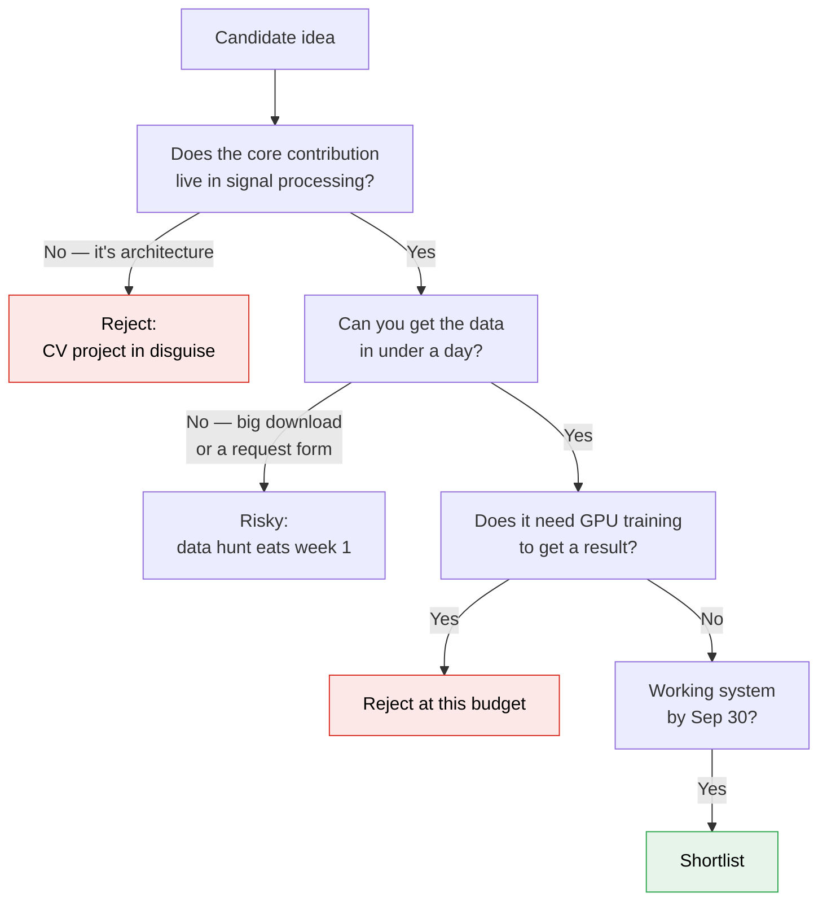

# DIP Final Project — idea catalogue

Companion to [[DIP-Project]]. **~30 researched options**, each explained in plain language with an
honest verdict on whether three people can actually do it.

> [!warning] Two dates have already passed — check where you actually stand
> The syllabus lists **group registration 📅 2026-08-17** and **project proposals 📅 2026-08-20**.
> Today is **2026-08-27**. Confirm with the instructor whether you are registered and whether a
> proposal is still accepted, before spending time choosing. **Projects are announced 2026-08-31.**

> [!info] What changed since the last version of this file
> The previous catalogue was written 2026-08-10 for a **1–2 person** team. This rewrite assumes
> **3 people**, accepts more risk, and treats **closed competitions as usable problem statements**
> rather than dead ends.

---

## The budget, honestly

**3 people × 3 h/week × ~7.5 working weeks ≈ 67 person-hours.** That is the number that decides
everything below.

| Milestone | Date | Working time from today |
|---|---|---|
| Projects announced | 2026-08-31 | 4 days |
| **Report 1** | 2026-09-30 (Wed) | **~4.5 weeks** |
| **Report 2** | 2026-10-26 | ~8.5 weeks |
| **Presentation** | 2026-11-12 | ~11 weeks |

> [!warning] The calendar lies — three weeks of it are already spoken for
> **Mid-terms 21–24 Sep** are near-zero capacity. **October is ~50% capacity**: DIP A3 due Oct 8,
> A4 out Oct 15, Quiz 2 on Oct 22, plus IRE and LMA projects landing 18–20 Nov.
> **Plan for a working end-to-end result by Report 1 (Sep 30).** Anything whose main implementation
> lands in November has already failed.

**Two consequences for choosing:**
1. **Data size is a bigger risk than difficulty.** A 12 GB download can cost you a week; a 330 MB one
   costs an afternoon. Every entry below states its data size for exactly this reason.
2. **Prefer projects where a negative result is still a result.** You said it yourself — *"what
   doesn't work is also a good result."* Projects shaped as *"does this published claim hold up?"*
   cannot produce nothing.

## The filter

**Read it as:** the decisive question isn't how hard the idea is, it's **who supplies the data**. If
you can synthesise your own degradations, you own perfect ground truth, week one is spent coding
rather than downloading, and you can sweep the degradation on a dial — which is exactly what makes a
"where does it break" study possible.

## Competitions — the honest status, so nobody re-searches

Checked across nine venues. **Everything relevant to Sept–Nov 2026 is closed:**

| Venue | Status |
|---|---|
| NTIRE 2026 (all tracks), ICIP 2026 Grand Challenges, ImageCLEF 2026, AI4Life | Closed; reports already published |
| LoViF @ ECCV 2026 | Paper deadline 2026-07-24; workshop 8–9 Sept. All tracks deep-learning anyway |
| IEEE GRSS Data Fusion Contest 2026 | Closed 2026-04-06 |
| Kaggle / Codabench / DrivenData | Nothing verifiable in the window; Kaggle CV is classification, i.e. deep learning |
| **IEEE SP Cup 2027** | **Not announced** — still "Call for Proposals", no topic, and historically not always image-related |
| grand-challenge.org | Open, but **3D medical segmentation only** — wrong subject, GPU-heavy |

> [!important] This doesn't matter, and here's why
> A closed challenge still gives you **a fixed task, a public dataset, an official metric, and a
> published leaderboard to score yourself against** — everything valuable about a competition except
> the submission button. Several entries below are exactly that: **ready-made problem statements with
> a known answer to compare against.** Use one as your proposal.

---

# The catalogue

Options are grouped by theme. **★ = recommended.** Each entry states its data size, because that is
the thing most likely to sink you.

---

## Group 1 · AI-image forensics

*Detecting AI-generated images using classical signal analysis — no neural network required.*

### 1A ★ SpAN — catching generators at the Nyquist frequency

**What it is, simply.** Image generators build pictures by repeatedly **upsampling** — starting small
and doubling the resolution again and again. Upsampling is interpolation, and interpolation leaves a
faint regular pattern behind. That pattern is invisible to your eye but shows up as **bright spots in
the Fourier transform**, strongest right at the highest representable frequency (the **Nyquist
frequency**). Real camera photos don't have those spots. So: take the FFT, look at the axial Nyquist
power, and you have a detector.

**Why it's interesting.** It is **completely training-free** — no dataset to learn from, no GPU, just
maths. And it lands exactly on [[../../Notes/Lec07-FrequencyDomain|Lecture 7]]'s Nyquist material:
you'd be applying the sampling theory you just learned to a 2025-era problem.

**What you'd do in week 1.** Load 20 real photos and 20 AI images. Compute the FFT of each, plot the
radial and axial power spectra, and see whether the Nyquist peaks are visibly different. That single
plot tells you if the project works.

**The extension that makes it large.** Detectors report ~99% accuracy in the lab but **collapse on
real social-media images**, because platforms recompress and resize everything, destroying the
traces (arXiv:2507.10236). So: **measure exactly how fast the detector dies** as you apply JPEG
compression, resizing, and screenshotting. That's a validity map, and it's a publishable-shaped
negative result.

| | |
|---|---|
| **Data** | ⚠️ Synthbuster is **12.4 GB in one zip** — cannot be partially downloaded. Use `TheKernel01/AIGC-Detection-Benchmark` on HuggingFace instead, or generate your own with any image generator |
| **3-way split** | A: spectral detector · B: degradation channel (JPEG/resize/social) · C: evaluation + baselines |
| **Units** | Sampling & aliasing, Fourier, compression, restoration |
| **Risk** | Low technically; **data logistics are the real risk** |
| **Verdict** | **Feasible and topical.** Verify your data source before committing |

*Sources: SpAN (OpenReview, Oct 2025) · Synthbuster (Bammey, IEEE OJSP 2024) · arXiv:2507.10236*

### 1B · PRNU sensor fingerprinting

**What it is, simply.** Every camera sensor has microscopic manufacturing flaws that make some pixels
slightly more light-sensitive than others. Average the noise from many photos by one camera and you
get a **fingerprint unique to that physical device** — you can then test whether a suspect photo came
from that exact camera. The twist: **AI-generated images have no PRNU at all**, because no sensor
ever saw them. That absence is itself a detection cue.

**Data.** ⚠️ PRNU-Bench is 13,000 images. Use **Dresden** or **VISION** subsets instead.
**Verdict:** feasible — wavelet denoising + correlation, all classical — but pick your subset carefully.

---

## Group 2 · Compression

### 2A ★ The codec bake-off — is JPEG actually obsolete?

**What it is, simply.** Four image formats compete today: **JPEG** (1992), **WebP**, **AVIF**, and
**JPEG XL**. Everyone says the new ones are better. Test it properly: compress the same images with
all four at matched file sizes, then measure quality *and* **how long encoding and decoding actually
take on a CPU**.

**Why it's interesting.** The verified 2025 reality is surprising: **JPEG is still 57% of web images;
AVIF is 0.7%** — and **AVIF encodes 10–100× slower than JPEG**. So the "better" format is losing in
practice. Your project finds **the regimes where plain old JPEG is still the right answer**, which is
a genuinely useful engineering result rather than a leaderboard chase.

**What you'd do in week 1.** Take the 24 Kodak images. Encode each at 5 quality levels in all four
formats. Plot file size against PSNR. That's a working rate-distortion curve by Friday.

**The twist that doubles the value.** Pair it with a **metric critique**: PSNR, SSIM and LPIPS are all
known to be attackable, and **the codec ranking flips depending on which metric you pick.** Showing
that is cheap and makes the project a statement about evaluation, not just about codecs.

| | |
|---|---|
| **Data** | **Kodak, 24 images.** Essentially zero download risk |
| **3-way split** | A: encode/decode harness + timing · B: metrics (PSNR/SSIM/MS-SSIM/LPIPS/butteraugli) · C: analysis + the metric-flip study |
| **Units** | Compression, colour (chroma subsampling), Fourier (DCT), IQA |
| **Risk** | **Very low.** Nothing can stop you getting a result |
| **Verdict** | **Safest large project here.** Scales smoothly — add chroma subsampling, progressive decode, or JXL lossless |

**Supporting papers to cite:** *Analysis and Enhancement of Lossless Image Compression in JPEG-XL*
(arXiv:2404.19755) — an honest published **negative** result; *JPEG AI Visual Artifacts*
(arXiv:2411.06810) — neural codecs fail **unpredictably** (hallucinated texture) where classical ones
fail **predictably** (blocking, ringing).

---

## Group 3 · Restoration and deconvolution

*Un-blurring. The mathematical core of Unit 6, taught 12–15 Oct — i.e. you'd be ahead of the course.*

### 3A ★ Five ways to deblur a space telescope

**What it is, simply.** A telescope smears every point of light into a small blob, called the **point
spread function (PSF)**. If you know the blob's shape, you can mathematically try to un-smear the
image — that's **deconvolution**. A 2024 *Astronomical Journal* paper compared **five** algorithms
head-to-head on simulated JWST data: Richardson–Lucy, Kraken, AIDA, sparse regularisation, and
iterative Wiener filtering.

**Why it's interesting.** It's a **published comparison you can replicate and then extend** — the
safest possible project shape. And critically, the `WebbPSF` package **simulates** the PSFs for you,
so **there is no large download**: you generate your own test data with perfect ground truth.

**What you'd do in week 1.** `pip install webbpsf`, generate a PSF, blur a clean image with it, add
noise, and run scikit-image's Richardson–Lucy. One afternoon to a working pipeline.

**The extension.** The paper compares methods at fixed noise. **You sweep the noise level** and chart
which algorithm wins where — plus the question every deconvolution paper dodges: *how many iterations
before Richardson–Lucy starts amplifying noise instead of recovering detail, and how would you know
without ground truth?*

| | |
|---|---|
| **Data** | **Simulated — none to download.** Optionally real Chandra/JWST archive images |
| **3-way split** | A: RL + Wiener · B: sparse/TV regularisation · C: PSF simulation, noise sweeps, metrics |
| **Units** | Restoration, Fourier, noise models |
| **Risk** | Low. Data cannot fail |
| **Verdict** | **Strong.** Real science domain, textbook methods, no download risk |

*Also: spatially-variant RL on Chandra (arXiv:2306.13355) — the same idea when the blur changes
across the image, which is where the standard theory breaks.*

### 3B · Lensless cameras — imaging with no lens at all

**What it is, simply.** Replace a camera's lens with a piece of textured plastic. Each point of the
scene now casts a complicated pattern onto the sensor instead of a focused dot, so the raw capture
looks like meaningless fog. But if you **know** that pattern, you can computationally invert it and
recover the image. This is real hardware people build for $50.

**Verdict:** feasible and unusual — `pip install lensless` ships working ADMM and Wiener baselines,
CPU is fine, and there's a **725 MB** DiffuserCam subset (⚠️ the full set is 100 GB — do not touch
it). No hardware needed. Best fit if you want the **computational imaging** unit.

---

## Group 4 · Low-light enhancement — the audit

### 4A ★★ "Do these published low-light numbers actually hold up?"

**What it is, simply.** Low-light enhancement takes a dark photo and brightens it without wrecking
it. The classical approach is **Retinex**: assume the photo = *what things actually look like*
(reflectance) × *how much light fell on them* (illumination), estimate the illumination, divide it
out. Two recent papers claim training-free improvements. **Both look shaky, and nobody has checked
either.**

**Why it's interesting — this is the strongest story in the whole catalogue.** Four separate
problems, all verified:

1. **A 2026 paper reports 17.74 dB** on the standard LOL benchmark and calls it *"the highest among
   the evaluated conventional methods"*. But **plain classical Retinex gets ≈18.23 dB** — so the
   paper's headline number is **below a baseline it did not evaluate.** (Learned methods reach ~24 dB
   for reference.)
2. **A second paper (HistRetinex) was rejected by IEEE TIP** — and says so openly in its own arXiv
   comments, citing reviewer concerns about "the experimental and algorithmic sections". It is still
   being cited.
3. **The metrics are broken.** The **LOE** metric was originally defined to compare the output
   against *the dark input image* rather than the ground truth — which is backwards. **NIQE**
   correlates poorly with what humans actually prefer.
4. **The "gt-mean" trick.** Many papers quietly rescale their output's brightness to match the ground
   truth before computing PSNR, which inflates the score substantially — and **they don't all
   disclose it.** So the published numbers **are not comparable with each other.**

**What you'd do in week 1.** Download LOL (under 1 GB), implement plain Retinex and CLAHE, and check
you reproduce the ≈18.23 dB literature value. **That one number validates your whole harness** — if
you can recover a known result for a known method, your verdict on an unknown method is credible.

**Why every outcome is a good outcome.** If the papers reproduce — the 2026 one is still worse than
the baseline it omitted, and that contrast is the finding. If they don't reproduce — that's a bigger
finding, and you publish the sensitivity analysis showing which unstated parameters it depends on.
If the noise-model ablation shows no difference — the paper's claimed novelty is inert, which is also
a finding. **There is no way to get nothing.**

| | |
|---|---|
| **Data** | **LOL-v1: 485+15 pairs, 400×600, <1 GB**, on HuggingFace (`geekyrakshit/LoL-Dataset`) |
| **3-way split** | A: reproduce paper 1 + its noise model · B: reproduce paper 2 + classical baselines · C: harness, metrics, the metric audit |
| **Units** | Intensity transforms, histograms, spatial filtering, colour, restoration — **4 of 6 units** |
| **Risk** | Low — designed so the failure modes *are* the deliverables |
| **Verdict** | **★★ Most complete story.** A full workstream/schedule/risk plan already exists for this one |

*Sources: arXiv:2608.09137 · arXiv:2510.21100 · LOL benchmark values from published comparisons*

---

## Group 5 · Dehazing — the assumption audit

### 5A ★★ "Does the Dark Channel Prior actually work outside the dataset it was tested on?"

**What it is, simply.** Haze makes distant things look washed out and grey. The famous fix is the
**Dark Channel Prior (DCP)**: in any small patch of a normal outdoor photo, *at least one colour
channel has some very dark pixel* (a shadow, a dark surface). Haze adds a uniform white veil that
lifts those dark pixels — so by measuring **how un-dark the darkest pixel is**, you can estimate how
much haze is present and subtract it.

**Why it's interesting.** DCP rests on **two assumptions that are both false in real photos**:
- **"Haze is uniform across the image."** Real fog is patchy.
- **"Every patch has a dark pixel."** **Sky regions don't** — the sky is bright in all channels, so
  DCP systematically fails there.

And here's the opening: **almost every published DCP number comes from RESIDE, which is
*synthetic* haze** — generated by applying the very physics model DCP assumes. **Of course it works
there.** Meanwhile there exist **four real-haze datasets** made with professional haze machines, one
of which (**NH-HAZE**) is *deliberately non-homogeneous* — built specifically to violate assumption 1.

**Your project:** run one DCP implementation across all four real datasets and **chart exactly where
and how the physics breaks.** That's not a horse race, it's a validity map — and
`Subjects/DIP/CLAUDE.md` explicitly asks for notes that *"state the assumptions of each technique"*.
This is that instruction turned into a project.

**What you'd do in week 1.** Download NH-HAZE (**330 MB, free, no registration — the smallest and
easiest dataset in this entire document**), implement DCP (~50 lines), and look at where it fails.

| | |
|---|---|
| **Data** | **NH-HAZE 55 pairs (330 MB, verified free)** · I-HAZE 35 · O-HAZE 45 · DNH-HAZE 50. All real haze, all small |
| **3-way split** | A: DCP + transmission refinement · B: the 2024 successors (Gabor, low-frequency DCP) · C: cross-dataset evaluation + sky/homogeneity failure analysis |
| **Units** | Restoration, colour, spatial filtering, Fourier (the low-frequency variant) |
| **Risk** | **Lowest of any option here.** The data is tiny and the method is 50 lines |
| **Verdict** | **★★ Best-scoped large project found.** Cannot fail to produce results |

**Extensions if it goes fast:** the 2024 *low-frequency-domain DCP* runs the prior on a low-passed
image for a big speedup — an FFT angle. And DCP's cousin, the **red-channel prior**, does the same
job underwater.

---

## Group 6 · The Fourier trilogy

*Three faces of one FFT toolkit — and it splits across three people almost too neatly.*

### 6A ★ Spectral texture anomaly detection

**Simply.** A woven fabric, a tiled floor, a wood grain — these are **near-periodic**, so their
Fourier spectrum is a few sharp peaks. A **defect** (a tear, a stain, a scratch) is *not* periodic, so
it spreads energy everywhere. Reconstruct the image from just the dominant peaks, subtract it from
the original, and **what's left is the defect.**
**Data:** ⚠️ MVTec AD is ~4.9 GB total — **download only the 5 texture classes**. The original paper
published classical baselines to compare against. Be honest that the *object* classes aren't
classically tractable.

### 6B ★ Automatic notch filtering for periodic noise

**Simply.** Repetitive interference — scan lines, sensor stripes, screen-door patterns — is a
sinusoid, and a sinusoid is **two bright dots in the Fourier transform**. Erase the dots
("**notch filtering**"), transform back, noise gone. Textbook so far. **The hard part, and the actual
project, is finding those dots automatically** rather than clicking them by hand.
**Data:** free — you add the noise yourself. Real satellite "destriping" is the applied version.

### 6C ★ Phase-correlation registration — how precisely can you align two images?

**Simply.** If one image is a shifted copy of another, that shift appears in the Fourier domain as a
**linear ramp in the phase**. So you can compute the exact offset directly, with no searching. Extend
it via log-polar coordinates (**Fourier–Mellin**) and you get rotation and scale too.
**Data:** free — you apply known shifts, so **ground truth is exact by construction.** That lets you
characterise accuracy against noise, overlap and illumination change exhaustively. Known ceiling is
~0.1 pixel.

> [!important] Why these three work well together
> One shared FFT harness, three independent applications, three people. And **every one of them
> generates its own ground truth**, so there is no download risk anywhere in the project. If the
> course's frequency-domain emphasis appeals to you, this is the most natural fit in the catalogue.

---

## Group 7 · Closed challenges as ready-made problems

*Fixed task, public data, official metric, published leaderboard to measure yourself against.*

### 7A ★ Reflection removal (NTIRE 2026)

**Simply.** Photograph something through a window and you get **two images added together** — what's
behind the glass, plus what's reflected in it. Separating them from a single photo is genuinely hard
because infinitely many pairs sum to the same picture. The classical insight: **reflections are
usually blurrier**, so in a gradient histogram the sharp edges belong to the real scene and the soft
ones to the reflection.

**Why it's a good proposal.** It's real layer separation, not classification. There's a published
leaderboard to compare against, and a strong classical baseline exists.
**Data:** OpenRR-5k on HuggingFace — **6.98 GB total, but split into separate zips**, so you can take
just the **300-pair validation set** (a few hundred MB). ✔ Practical.

### 7B · Shadow removal (NTIRE 2025)

**Simply.** Given a photo with a shadow and the same scene without one, learn to remove shadows.
Classically it's an **illumination-ratio** problem: a shadow multiplies a region by some factor, so
estimate that factor per pixel and divide it out. Closely related to colour constancy.
⚠️ WSRD+ may require a data request form — check before committing.

### 7C · Denoising (NTIRE 2026) and 7D · Burst HDR (NTIRE 2025)

Denoising: run **BM3D** (the classical champion) against the leaderboard and report the honest gap.
Burst HDR: merge 9 misaligned RAW frames — the classical half is **alignment by phase correlation**
(see 6C) plus robust merging. ⚠️ RAW burst data is the likely >5 GB item; verify first.

---

## Group 8 · Colour and perception

### 8A ★ The colour constancy metric trap

**Simply.** **Colour constancy** is guessing what colour the light was, so you can cancel it out —
that's what "auto white balance" does. There are classical estimators that are each about 30 lines:
Grey-World (assume the average scene is grey), max-RGB, Shades-of-Grey, Grey-Edge, Gamut Mapping.

**The interesting part is the evaluation, not the algorithms.** Two verified scandals:
- There are **two different ways to measure the error** (*recovery* vs *reproduction* angular error),
  and **they rank methods differently.**
- The standard benchmark's **ground truth was wrong for years** — Hemrit et al. published
  *Rehabilitating the ColorChecker Dataset* (arXiv:1805.12262), meaning a large body of published
  numbers refer to broken labels.

**Your project:** implement five classical estimators, evaluate under **both metrics and both
versions of the ground truth**, and show how the ranking moves. Cheap to build, strong result.
⚠️ Use pre-processed versions — the NUS-8 RAW files are large.

### 8B · Underwater enhancement and the gameable metric

**Simply.** Water absorbs red light first, so deep photos go blue-green. Physics-based correction
inverts that attenuation. **The catch:** the standard benchmark's "ground truth" images are
**human-picked best outputs of older algorithms**, not real ground truth — so scoring well means
*agreeing with 2019's algorithms.* And the no-reference metrics everyone quotes (**UIQM/UCIQE**) can
be **raised by simply oversaturating the image**. Demonstrating that you can score higher while
looking visibly worse is a compact, memorable result. **Data:** UIEB, 950 images, small.

### 8C · Colour illusions and constancy (ACCV 2024 / IJCV 2025)

A rare recent **non-deep-learning** paper at a top venue: one traditional model that does colour
constancy, **explains visual illusions**, and applies to low-light enhancement. Fits this subject's
"trace it back to the eye" instinct exactly. Reproducing it is a defensible project by itself.

---

## Group 9 · Smaller, well-defined options

*Good as a second workstream, or as a project if paired.*

### 9A ★ Inverse halftoning — undoing newspaper dots

**Simply.** Printers can only print ink or no-ink, so continuous shading is faked with patterns of
dots (**halftoning**). Undoing that is the project. The lovely part: **ordered dithering** uses a
regular grid, so its pattern is periodic and **removable in the frequency domain** — but **error
diffusion** produces an irregular "blue noise" pattern that **isn't** periodic, so the same trick
fails. *Explaining why is half the report.*
**Data: free** — you halftone your own images (Floyd–Steinberg, Jarvis, Bayer, clustered-dot), so
ground truth is exact. Extend to **real scanned comics**, where the screen angle and frequency are
unknown and must be **estimated from the spectrum**.

### 9B · Stain normalisation across 66 labs

**Simply.** Histology slides are dyed, and every lab's dye comes out a slightly different colour, so
software trained in one hospital fails in another. Classical fix: **unmix the two dyes**. Take the
log of the image (Beer–Lambert law) to get "optical density", where dye concentrations add linearly,
then find the two dye colour-vectors (Macenko uses SVD; Vahadane uses sparse NMF) and renormalise.
**A 2025 dataset has the same tissue stained by 66 different labs** — real, hard variation.
⚠️ Work on extracted tiles, not whole slides.

### 9C · Retinal vessel enhancement

**Simply.** Blood vessels in a retina photo are thin dark lines. Match them with filters shaped like
thin lines at many orientations and scales — matched filters, **Frangi vesselness** (based on Hessian
eigenvalues), Gabor. The project is comparing **which filter family wins where**.
**Data: tiny** — DRIVE (40 images) + STARE (20). Runs in under 10 s/image.
⚠️ **Possibly too small alone** — pair it with another option.

### 9D · Tone mapping and the biased metric

**Simply.** HDR images have a wider brightness range than a screen can show, so a **tone-mapping
operator** squeezes it down. The standard quality metric is **TMQI** — but its structural term is
SSIM-derived, which **biases it toward local operators**, so local methods win partly *by
construction*. Implement Reinhard, Drago, Durand, Mantiuk and Fattal from scratch, then show a
tone-mapper **optimised for TMQI that looks bad**.

### 9E · Steganalysis — detecting hidden messages

**Simply.** Hiding data in an image perturbs its least-significant bits. The classical detector
(**SRM**) computes thousands of tiny local noise statistics and feeds them to a classifier — >99%
detection on older schemes. **The known failure:** detectors trained on one dataset (BOSSbase)
**collapse on a harder one (ALASKA#2)** — a ready-made generalisation-failure study.
Pairs neatly with **Assignment 1's P2**, so you'd start with code you already wrote.
⚠️ Full SRM is 34,671 features — use a reduced subset.

### 9F · Document binarization audit

**Simply.** Old manuscripts are stained and faded; before you can read them you must decide per pixel
"ink or page?" A 2025 study compared **ten classical thresholding methods** (Otsu, Niblack, Sauvola,
ISODATA…) against a U-Net on Balinese palm-leaf manuscripts. **Data is tiny: 19 + 100 images.** The
deep model won — so this is an honest-negative-result project with a published number to check.

### 9G · Build a camera ISP from scratch

**Simply.** Your phone turns raw sensor data into a JPEG through a fixed chain: **demosaic** (the
sensor only sees one colour per pixel behind a Bayer filter) → white balance → colour matrix → tone
curve → gamma. Implementing that chain from scratch is an excellent self-contained exercise hitting
colour *and* sampling. Reversing it is the ambitious half.
⚠️ Full MIT-Adobe FiveK is ~50 GB — subset only.

### 9H · Film grain synthesis

**Simply.** Film grain is noise, and noise compresses terribly — so modern codecs (AV1) **throw the
grain away**, then **re-synthesise fake grain at the decoder** from a tiny autoregressive model whose
parameters ride along as metadata. Classical signal processing, no data needed, and it ties
compression to texture and perception.

### 9I · Exposure fusion

**Simply.** Instead of computing a physically-correct HDR image and then tone-mapping it, just blend
the bracketed exposures directly: score every pixel on contrast, saturation and well-exposedness, and
blend through a **Laplacian pyramid** so there are no seams. The same code does **focus stacking**.
⚠️ **Two afternoons of work — a component, not a project.** But it's the cleanest possible excuse to
implement pyramids.

---

## Honest dead ends

> [!warning] Things that sound good and aren't — checked so you don't have to
> **"Classical segmentation still beats deep learning."** It doesn't, and I looked hard. SAM2 beats
> SLIC and Felzenszwalb; a U-Net beat all ten classical methods on the palm-leaf benchmark. The field
> has moved to **hybrids** (e.g. Superpixel Anything, BMVC 2025 — classical superpixels constrained
> by a SAM prior). Only pursue this if you *want* the negative result.
>
> **Entering a live competition.** See the status table above — nine venues checked, all closed or
> wrong-shaped. Use a closed one's data and metric instead.

---

# Everything at a glance

| # | Option | Data size | Risk | Units | Verdict |
|---|---|---|---|---|---|
| **5A** | **★★ DCP dehazing assumption audit** | **330 MB** | **Very low** | Restoration, colour, Fourier | **Best-scoped** |
| **4A** | **★★ Low-light reproduction audit** | **<1 GB** | Low | 4 of 6 units | **Best story** |
| **2A** | ★ Codec bake-off + metric flip | **24 images** | Very low | Compression, colour, DCT | **Safest** |
| **6A–C** | ★ Fourier trilogy (texture / notch / registration) | free–4.9 GB | Low | Fourier throughout | **Best 3-way split** |
| **3A** | ★ JWST five-way deconvolution | **simulated** | Low | Restoration, Fourier | Strong |
| **1A** | ★ SpAN spectral forensics | ⚠️ 12.4 GB or alt. | Low–med | Sampling, Fourier | Most topical |
| **7A** | ★ Reflection removal (NTIRE) | ~300 MB subset | Medium | Restoration, gradients | Good proposal |
| **8A** | ★ Colour constancy metric trap | medium | Low | Colour | Strong, cheap |
| 9A | Inverse halftoning | **free** | Low | Fourier, sampling | Fun, small |
| 3B | Lensless imaging | 725 MB | Medium | Comp. imaging | Unusual |
| 7B | Shadow removal | ⚠️ request form | Medium | Colour, intrinsic | Good if data arrives |
| 8B | Underwater + gameable metric | small | Low | Colour, IQA | Memorable result |
| 9B | Stain normalisation (66 labs) | tiles only | Low | Colour | Well-defined |
| 9D | Tone mapping + TMQI bias | small | Low | HDR, IQA | Good |
| 9E | Steganalysis | subset | Medium | Filtering, stats | Reuses A1 code |
| 9C | Retinal vessels | **60 images** | Very low | Filtering | ⚠️ too small alone |
| 9F | Document binarization | **119 images** | Very low | Thresholding | ⚠️ small |
| 1B | PRNU fingerprinting | subset | Medium | Noise, wavelets | Feasible |
| 7C/D | Denoising / Burst HDR | ⚠️ large | Medium | Restoration | Verify size |
| 9G | Camera ISP from scratch | ⚠️ 50 GB full | Medium | Colour, sampling | Subset only |
| 8C | Colour illusions + constancy | small | Medium | Colour, HVS | Rare non-DL paper |
| 9H | Film grain synthesis | **none** | Low | Compression, texture | Niche, delightful |
| 9I | Exposure fusion | small | Very low | Pyramids | Component only |

---

# If you want a recommendation

**Pick one of these two, and you will have a good project regardless of how the results turn out:**

### 1. DCP dehazing audit (5A) — if you want the safest large project
330 MB of data, a 50-line core algorithm, four real benchmarks, and a question with a guaranteed
answer: *where do these two assumptions break, and by how much?* You cannot end the semester with
nothing. It also directly instantiates this subject's own rule about stating assumptions.

### 2. Low-light audit (4A) — if you want the best story to present
A published paper whose headline number sits **below the baseline it declined to evaluate**, a second
paper **rejected by IEEE TIP that people still cite**, and a metric literature where **the numbers
aren't comparable at all.** The opening slide writes itself. There's a fully worked plan for this one
— workstreams, week-by-week schedule, risk register and de-scope ladder — ask and I'll drop it in.

**If you want the cleanest three-way split:** the **Fourier trilogy (6A–C)**, because all three parts
generate their own ground truth and share one FFT harness.

**If you want a leaderboard to chase:** **reflection removal (7A)** — public data, official metric,
published results to measure against.

> [!important] Whichever you pick, the shape that earns marks is the same
> **Reproduce something known → verify your harness against it → then attack one assumption.**
> The reproduction guarantees you a deliverable; the attack supplies the novelty. And say in the
> proposal that you are **not** trying to beat state-of-the-art — that framing protects you if the
> numbers come out low, and it's what makes a negative result publishable rather than embarrassing.

---

## Next actions

- [ ] **Confirm registration + proposal status with the instructor** (both dates have passed) 📅 2026-08-28
- [ ] Pick a shortlist of 2 and check the data actually downloads 📅 2026-08-29
- [ ] Decide the option and assign the three workstreams 📅 2026-08-31
- [ ] Create the GitHub repo — **check-in analytics are graded, so start the history now** 📅 2026-08-31
- [ ] Write the proposal, including "we are not trying to beat SOTA" 📅 2026-09-01
- [ ] File the chosen papers into [[../../Reading-Materials/README|Reading-Materials]] 📅 2026-09-02

## How to generate more ideas yourself

Four moves that reliably produce a good DIP project:

1. **Attack an assumption.** Every technique ships with assumptions stated once and then relied on
   silently — additive vs multiplicative noise, Gaussian vs Poisson, shift invariance, stationarity,
   single illuminant, band-limited signal, known blur kernel. **Pick one, violate it gradually, and
   measure the collapse.** Options 5A, 4A and 8A are all this move.
2. **Cross the domain.** Take a method from one unit and apply it where it doesn't belong. Morphology
   on spectrograms; Fourier analysis of morphological operators. It forces you to state what the
   method *actually* assumes about its input.
3. **Classical vs learned — on terrain where classical should win.** Never "our CNN beats the
   baseline". Invert it: find the regime where the classical method *should* win (out-of-distribution
   degradation, tiny data, no training budget, interpretability) and test whether it does.
4. **Reproduce, then perturb.** Pick a paper whose contribution is a **transform, a prior, or a
   degradation model** — never an architecture. Reproduce the headline number, then change one thing
   the authors held fixed.

**The 20-minute version:** open `_syllabus.md`, pick the unit you find most interesting, write down
its three main methods, and for each write *"this works only if ___"*. Then ask whether that holds in
a real photograph. Every "no" is a candidate project — **provided you can synthesise data that
violates it on a dial from mild to severe.**

---
[[DIP-Project]] · [[../../_syllabus|DIP syllabus]] · [[Dashboard]]
