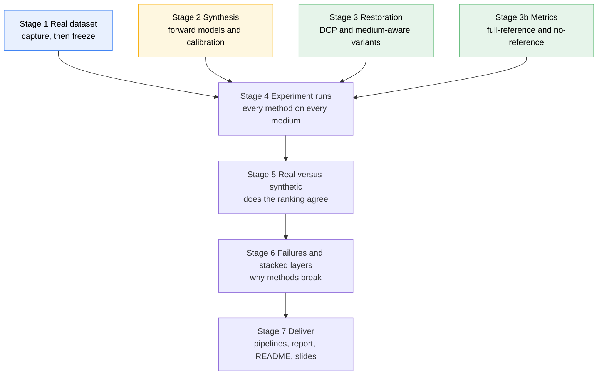
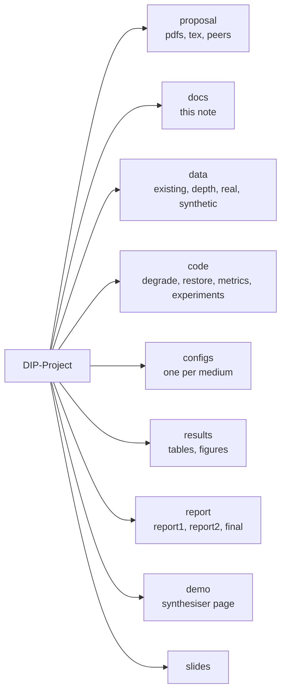

# DIP Project — the stages, in plain words

**Project:** *Restoring Visibility Through Haze, Water, Glass and Plastic* — which **classical, non-learning** methods restore visibility best in each case, why, and how far a synthetic degradation can stand in for a real capture. The Dark Channel Prior (DCP) is the baseline. Source: `proposal/DIP_Project_Proposal_v2.pdf` (10 deliverables, D1 to D10). The longer 16-deliverable earlier version is `proposal/DIP_Project_Proposal_Reframed.pdf`; this note follows **v2**. Tracking is in [[Subjects/DIP/Projects/DIP-Project/DIP-Project|DIP-Project]]; findings and changes are in [[Subjects/DIP/Projects/DIP-Project/log|log]]; datasets are in [[Subjects/DIP/Projects/DIP-Project/data/README|data/README]].

> [!important]
> **The constraint that shapes everything:** no machine learning in any restoration or degradation step, and no learned depth model. Anything under study (DCP, medium-aware variants, forward models, the analysis metrics) is **written by hand**; only generic primitives (guided filter, CLAHE, Wiener, PSNR/SSIM) may use a library, and library use for baselines is still to be confirmed with the instructor.

## The map

*Read it as:* blue, amber and green are three tracks that can run **at the same time** (real data, synthetic data, restoration code). They all feed Stage 4; from there the work is strictly one after another. Restoration code is developed on public images while your own captures are still being taken.

## The stages

| # | Stage | Deliverable (v2) | What happens | Folder | Owner |
|---|---|---|---|---|---|
| 1 | **Real dataset** (public sets curated; own captures still to do) | D1 | Capture haze, water, glass and plastic scenes at three severity levels each, plus a clear reference shot of each scene. Freeze the set so later work doesn't move. | `data/real/` | A |
| 2 | **Synthesis** (built: `code/degrade/` and `demo/`) | D2, D3 | Write the forward models and calibrate them on a few scenes, test on held-out ones. Make *matched* synthetic images (degrade your own clear references) and *bulk* ones (from public depth maps). | `code/degrade/`, `data/synthetic/` | C |
| 3 | **Restoration** (built: `code/restore/`, 38 methods) | D4, D5 | DCP from scratch (dark channel, atmospheric light, transmission, recovery), refinement, then medium-aware variants (UDCP, per-channel or local light, homomorphic, Wiener, Retinex, CLAHE). | `code/restore/`, `configs/` | B |
| 3b | **Metrics** (built: `code/metrics/`) | D6 | PSNR, SSIM, CIEDE2000 from libraries; UCIQE, entropy, contrast, dark-channel histograms, model-fit residual and ranking correlation by hand. | `code/metrics/` | B |
| 4 | **Experiment runs** (done: `code/experiments/`, results in [[Subjects/DIP/Projects/DIP-Project/docs/results-analysis|results-analysis]]) | D7 | One runner applies every method to every medium (real and synthetic), the choice of modules per medium coming from a config file. | `code/experiments/`, `results/tables/` | B |
| 5 | **Real versus synthetic** (done: `compare_real_vs_synthetic.py`) | D8 | Compare method rankings on real and synthetic data. Report the gap openly: haze made with the model DCP inverts favours DCP by construction. | `results/` | C |
| 6 | **Failures and stacked layers** | D9 | Explain failures with dark-channel statistics, transmission and colour-cast analysis. Shoot a scene through a fogged or dirty pane (two layers). | `results/figures/`, `data/real/stacked/` | B, A |
| 7 | **Deliver** | D10 | A recommended simple pipeline per medium, the report sections, README, slides and rehearsal. | `report/`, `slides/` | all |

### Stages added after the first plan (all run; details in `log.md`)
| # | Stage | Script | Question |
|---|---|---|---|
| 2d to 2f | Calibrate the synthetic models | `tune_models.py`, `check_scene_matched.py`, `tune_milky_water.py` | Do made-up pictures look and rank like real ones? Calibrated haze and glass; milky water for the tank |
| 4b to 4d | Sweeps, severity, step order | `run_sweeps.py`, `run_severity_sweep.py`, `run_pipelines.py` | What settings and what order of steps work? |
| 4e | Global against local | `run_local_vs_global.py` (tile sweep: `--tile-sweep`) | Should a method act on the whole picture or tile by tile? |
| 4f | Subtraction with other tools | `run_subtraction_combos.py` | Does haze removal by subtraction combine well? |
| 4g, 4h, 4i | How long a chain | `analyse_chain_limits.py`, `run_longer_chains.py`, `run_longer_chains_real.py` | Do chains of 4 and 5 steps help? (No) |
| 2g to 2i | More scenes, outdoor scenes, refined haze | `run_outdoor_haze.py`, `check_model_refinements.py`, `tune_refined_haze.py` (`degrade/haze_refined.py`) | Is the haze ranking stable with 90 scenes? Do outdoor scenes or per-colour glow and blur make the synthetic haze rank the methods like real haze? |
| 5b | Stability of the agreement numbers | `check_agreement_stability.py` | Bootstrap intervals for every synthetic-against-real rank agreement |
| 4j | Where the gap to the best possible comes from | `analyse_gap.py` | Give DCP the true glow and the true transmission one piece at a time |
| 4k | Settings inside the best chains | `tune_chain_params.py` | Should the parameters of the best real-picture chains change? |
| 4l | Chains derived from the inverse equations | `run_theory_chains.py` (`stretch_rgb` in `restore/baselines.py`) | Do chains that follow the inverse beat the earlier searches, and had they been tried? |
| 4m | Beyond repair | `analyse_beyond_repair.py` | Which pictures have lost the information a repair needs? |
| 6a, 6b, 2c, 7 | Earlier stages | `run_failure_analysis.py`, `run_stacked.py`, `validate_models.py`, `run_frequency_analysis.py` | Why methods fail; stacked layers; model validation; frequency-domain study |
| 7b | Report assets | `make_report_figures.py`, `make_report_tables.py`, `make_pipeline_figures.py`, `make_water_figures.py`, `make_data_gallery.py`, `make_theory_figure.py` | Figures and tables for `report/final/report.tex` |

### What each stage assumes (the viva questions live here)
- **Stage 2:** haze `t = exp(−β·d)`, water per-channel `t_c = exp(−β_c·d)` with red absorbed fastest, glass as a low-frequency veil plus droplet or smudge masks, plastic as low transmission plus tint plus blur, stacked as `I2 = J·t1·t2 + A1·t2·(1 − t1) + A2·(1 − t2)`. Depth comes from measured distances, a planar ramp or 2–3 hand-defined layers.
- **Stage 3:** DCP assumes that in a haze-free outdoor patch at least one colour channel is near zero. It breaks on white or bright objects, on water (red is gone) and on glass (the veil is not distance-dependent).
- **Stage 5:** a synthetic set is trusted only to the extent that its ranking of methods matches the real one.

### If time runs out (the proposal's cut list)
Cut in this order: soft matting → Retinex → plastic stacked-layer cases → bulk severity sweeps. **Must survive:** real captures, DCP plus 2 or 3 classical alternatives, matched synthetic data, the ranking-agreement comparison.

## Folder map

*Read it as:* inputs live in `data/` (raw downloads untouched, a curated working set beside them), code in `code/` driven by `configs/`, the interactive synthesiser in `demo/`, outputs in `results/`, and the write-ups in `report/` and `slides/`. Datasets stay in `data/` only (the vault rule), so they never end up in the code or a submission.
